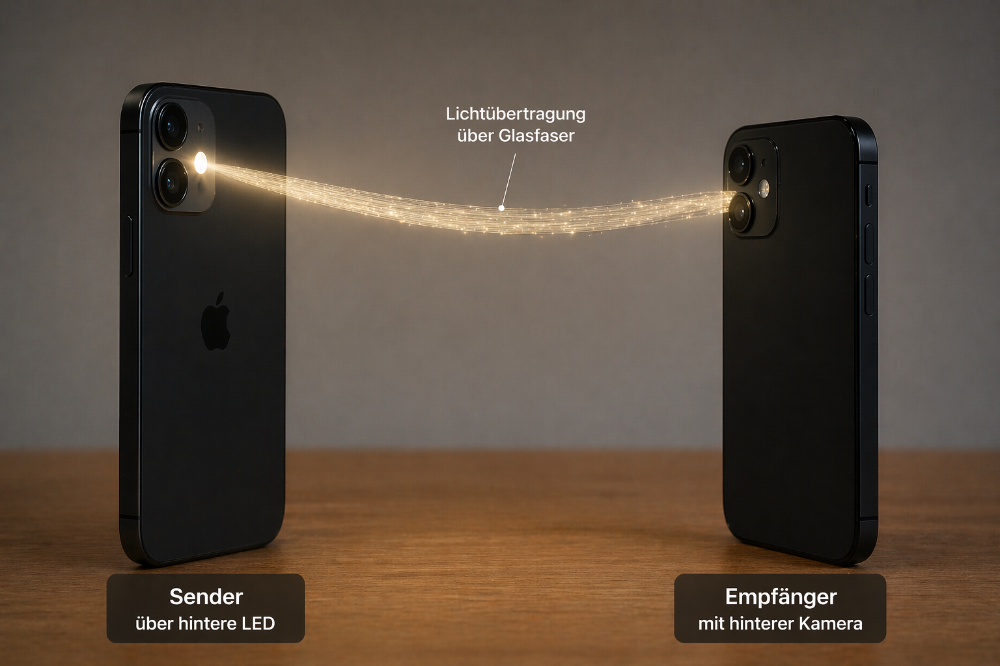
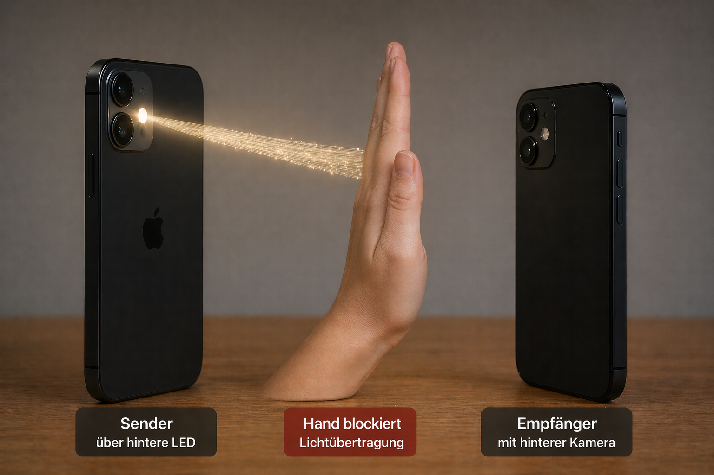
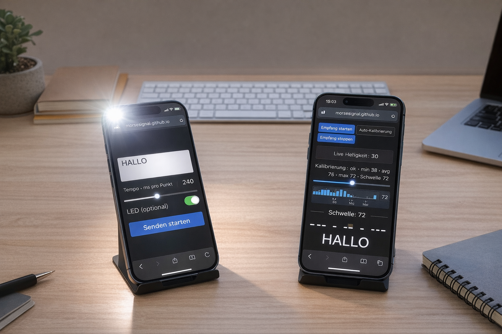
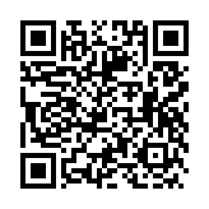

# Morse Light Webapp

[🇩🇪 Deutsch](README.md) · 🇬🇧 English

Install-free web app for Morse code with light on the iPhone: send via the screen and optionally via the LED, receive via the camera and decode live.

This setup can be used to show what happens to data transmission when the light beam in an optical fiber is interrupted.

**Project summary: Morse Light Webapp for iPhone**

This project is a browser-based web application that demonstrates how Morse code can be transmitted and received using light between two iPhones, without installing a native app.

One iPhone acts as the **sender**. It converts user-entered text into Morse code and transmits it as light pulses, using the screen as a reliable fallback and, where supported, the rear LED flash.

The second iPhone acts as the **receiver**. It uses the rear camera to detect incoming light pulses, analyzes brightness changes in real time, and decodes them back into text inside the web app.

The project includes several usability and reliability improvements:

* text-to-Morse conversion
* adjustable transmission speed
* optional rear/front camera selection
* automatic receiver calibration
* simplified receiver interface
* centered detection window for more robust signal capture
* an auto-start receiver mode with one main start button
* GitHub Pages deployment support

The goal of the project is to create an easy-to-understand, installation-free demonstration of **optical communication**, showing how information can be transmitted with light in a simple and visual way.

A second visual concept was also created to illustrate how light transmission could be guided through **fiber optics**, and how the signal can be interrupted if an object blocks the optical path.

 

 

## Overview

This web app is meant for two iPhones:

- **Sender iPhone**: sends Morse code as light pulses
- **Receiver iPhone**: detects the light pulses with the camera and decodes them into text

> The app interface is in German.

The app runs directly in the browser and doesn't need to be installed. Open the following link on both iPhones or scan the QR code.

https://tbr-brd.github.io/morse-light-webapp/

## Features

- Text input with automatic conversion to Morse
- Sending via **screen flash**
- Optional attempt to switch the **iPhone LED** from the browser
- Receiving via the camera on a second iPhone
- Live display of the Morse code and the decoded text
- **Auto-calibration** of the brightness threshold

## Important note on iPhones

Flashlight/LED control in the mobile browser is not reliably available on every iPhone or in every Safari version. That's why the **screen flash** is built in as a robust fallback.

## Files in the repository

- `index.html` – the complete web app in a single file
- `README.md` – the German guide
- `README_EN.md` – this guide
- `LICENSE` – MIT license
- `repo-description.txt` – short description for GitHub

## Using it with two iPhones

### Auto-start version

- large start button for the receiver
- camera starts automatically
- automatic calibration right after starting
- detection window in the middle of the image
- focus on the decoded text

## Test procedure

1. Receiver: tap **start receiving automatically** ("Empfang automatisch starten")
2. Wait until it shows **ready to receive** ("Bereit zum Empfangen")
3. Sender: send a message
4. Keep the light inside the green detection window

## Troubleshooting

### Camera doesn't work
- Check that the page was opened via **HTTPS**
- Allow camera access in Safari
- Reload the page

### LED doesn't work
- This is not always supported in the browser on iPhones
- In that case, use the **screen flash**

### Decoding is unreliable
- Set a slower speed
- Choose a darker environment
- Point the camera more precisely at the sender
- Run the auto-calibration again
- Adjust the threshold manually

## Alternative to GitHub Pages

The file can also be hosted directly on **Vercel**. Since everything is in a single HTML file, no build process is needed.

## GitHub short description

The content of `repo-description.txt` can be used as the repository description on GitHub.
